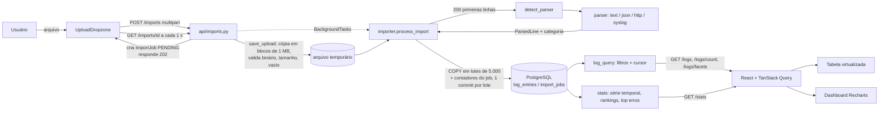

# Arquitetura

## Componentes

| Componente | Tecnologia | Responsabilidade |
| --- | --- | --- |
| `web` | React 18 + TypeScript + Vite, servido por Nginx (porta 5173 → 80) | Telas de Dashboard, Logs e Importar. SPA estática; o Nginx só serve arquivos e faz fallback para `index.html`. |
| `api` | FastAPI + SQLAlchemy 2 + psycopg 3 (porta 8000) | Upload, processamento em segundo plano, consulta, facetas e estatísticas. |
| `db` | PostgreSQL 16 | Armazenamento, índices, full-text e agregações. |

O backend é dividido em camadas, cada uma chamando só a de baixo:

- `app/api`: rotas, validação de parâmetros e schemas de resposta (Pydantic). Não contém regra de negócio.
- `app/services`: `importer` (upload e ingestão), `log_query` (filtros, cursor, facetas) e `stats` (agregações).
- `app/parsers`: funções puras que transformam uma linha de texto em `ParsedLine` e não acessam o banco.
- `app/models`: tabelas `import_jobs` e `log_entries` e seus índices.

O contrato entre parsers e importador é `ParsedLine` (`app/parsers/base.py`). O contrato entre backend e frontend é
[docs/api.md](api.md).

## Fluxo de dados



1. **Upload** (`POST /imports`): o handler é síncrono, então roda no threadpool e não bloqueia o event loop.
   `save_upload` copia o arquivo para um arquivo temporário em blocos de 1 MB. Se o primeiro KB tem byte NUL, a
   resposta é 415; se passa de `UPLOAD_MAX_MB`, 413; se o arquivo está vazio, 422. Depois disso o job é criado
   como `PENDING` e a resposta é `202` com o job.
2. **Processamento em segundo plano** (`process_import`, com sessão própria): marca `PROCESSING`, detecta o formato
   pelas 200 primeiras linhas não vazias (vence o parser com mais acertos; em empate, o mais específico) e grava o
   nome em `format`. Lê o arquivo linha a linha, em UTF-8 com BOM opcional e bytes inválidos trocados por U+FFFD.
   Linhas em branco são ignoradas e linhas que o parser rejeita entram em `invalid_lines`.
3. **Ingestão**: a cada 5.000 linhas, um `COPY log_entries (...) FROM STDIN` e a atualização dos contadores do job
   vão na mesma transação. Assim o progresso exibido sempre corresponde ao que está gravado. No fim, o job fica
   `DONE` e o arquivo temporário é apagado.
4. **Consulta**: `/logs` e `/stats` usam o mesmo construtor de filtros (`log_query.build_conditions`), então a
   tabela e o dashboard sempre concordam sobre o que é "o filtro atual".
5. **Frontend**: a tela de importação consulta o job a cada segundo. Um observador montado em `App` percebe quando
   qualquer importação termina e atualiza logs, contagem, estatísticas e facetas, em qualquer página.

## Modelo de dados

`import_jobs`: `id`, `filename`, `status` (PENDING/PROCESSING/DONE/FAILED), `format`, `total_lines`,
`parsed_lines`, `invalid_lines`, `error`, `created_at`, `finished_at`.

`log_entries`: `id` (bigint), `import_id` (FK com `ON DELETE CASCADE`), `timestamp` (timestamptz, UTC), `level`
(enum), `service` (até 100), `category` (até 50), `message`, `raw` (linha original; ambos cortados em 10.000
caracteres) e `search_vector`.

| Índice | Colunas | Para quê |
| --- | --- | --- |
| `ix_log_ts_id` | `timestamp DESC, id DESC` | Ordenação fixa da tabela e paginação por cursor sem ordenar em memória. |
| `ix_log_level_ts` | `level, timestamp DESC` | Filtro por nível (o mais comum) mantendo a ordem. |
| `ix_log_import_ts_id` | `import_id, timestamp DESC, id DESC` | Filtro por importação na ordem da tabela; também evita varredura completa no `ON DELETE CASCADE`. |
| `ix_log_service`, `ix_log_category` | `service`, `category` | Filtros por igualdade e facetas (`DISTINCT`). |
| `ix_log_search` | GIN em `search_vector` | Busca textual. |

Os índices são criados na subida da API com `CREATE INDEX IF NOT EXISTS`, depois de `create_all` (veja
[decisions.md](decisions.md#6-esquema-com-create_all--if-not-exists-sem-alembic)).

## Paginação por cursor

A ordenação é fixa: `timestamp DESC, id DESC`. O cursor é `base64url("<timestamp ISO>|<id>")` do último item da
página, e a próxima página usa uma comparação de tuplas:

```sql
WHERE (timestamp, id) < (:ts, :id) ORDER BY timestamp DESC, id DESC LIMIT :limit + 1
```

Essa comparação segue a ordem de `ix_log_ts_id`, então o Postgres começa a ler exatamente no cursor. O custo é o
mesmo na página 1 ou na 1.000, e linhas novas não deslocam as páginas (não há duplicadas nem puladas). A consulta
pede `limit + 1` linhas para saber se existe próxima página sem fazer um `COUNT`. O total vem de uma rota separada,
`/logs/count`. Um cursor inválido devolve 422 ("Cursor de paginação inválido.").

## Busca textual

`search_vector` é uma coluna gerada pelo Postgres:

```sql
to_tsvector('simple', coalesce(service, '') || ' ' || message)  -- STORED, índice GIN
```

A configuração `simple` não aplica stemming nem stopwords. Isso é intencional: logs têm identificadores, nomes de
serviço e termos técnicos em inglês, que um dicionário de idioma deformaria. Por ser coluna gerada, o vetor nunca
fica desatualizado em relação à linha e o `COPY` não precisa calculá-lo.

Como o parâmetro `q` vira consulta (`log_query._text_condition`):

| Entrada | Consulta | Exemplo |
| --- | --- | --- |
| Palavras simples | `to_tsquery('simple', 'tok1:* & tok2:*')`: todas as palavras, por prefixo | `time pay` encontra "timeout calling payments" |
| Com aspas, ` or ` ou termo começando com `-` | `websearch_to_tsquery('simple', q)` | `"connection refused"`, `timeout or database`, `-payments` |
| Sem letras nem dígitos | `ILIKE '%...%'` em mensagem e serviço, com `%` e `_` escapados | `%` |

Os tokens do modo prefixo são extraídos com `[^\W_]+` (só letras e dígitos), então não carregam operadores de
tsquery. Além disso, o texto sempre vai como parâmetro ligado (bind), nunca concatenado na SQL.

## Estatísticas

`/stats` faz uma única varredura agrupada por `date_bin('1 hour', timestamp)` e nível, que gera ao mesmo tempo os
totais por nível, a série temporal e o primeiro e último timestamp. Quando o modo automático escolhe `day`
(intervalo acima de 3 dias), as horas são somadas em dias na aplicação, sem uma segunda consulta. Buckets vazios
são preenchidos com zero (até 10.000 buckets). Top serviços, top categorias e erros mais frequentes são consultas
`GROUP BY ... LIMIT 10`. Nos erros, os números da mensagem são trocados por `#` (`regexp_replace`), para juntar
variações como `timeout calling auth after #ms`.

## Frontend

- **Estado do servidor**: TanStack Query. A tabela usa `useInfiniteQuery` com `next_cursor` como `pageParam`
  (páginas de 200). Enquanto um filtro novo carrega, `keepPreviousData` mantém as linhas anteriores esmaecidas em vez
  de piscar um skeleton. Os logs são imutáveis depois de importados, então `staleTime` é de 5 min e não há refetch
  ao focar a janela. Ao fim de uma importação, a lista de logs é resetada (não invalidada, para não refazer todas as
  páginas já carregadas).
- **Filtros na URL**: `useUrlFilters` lê e escreve os filtros em `searchParams` com `replace`, o que deixa a visão
  compartilhável, faz ela sobreviver ao recarregar e evita que o botão Voltar desfaça cada tecla digitada. A busca
  tem debounce. Os cliques no dashboard (ponto da série, nível, serviço, categoria, erro frequente) levam para
  `/logs` com os filtros correspondentes.
- **Virtualização**: `@tanstack/react-virtual` renderiza só as linhas visíveis, mesmo com milhares carregadas. Perto
  do fim da lista, a próxima página é buscada (scroll infinito). Abaixo do breakpoint compacto, as linhas viram
  cartões e a tabela continua virtualizada.
- **Code splitting**: as três páginas são `lazy`. O Recharts fica só no chunk do dashboard, então a tela de logs
  não o baixa.
- **Estilo**: CSS próprio com variáveis (`frontend/src/index.css`), com tema claro/escuro via `data-theme`.

## Tratamento de erros

Na API:

- Todo erro devolvido ao usuário tem o formato `{"detail": "mensagem em português"}`. O handler de
  `RequestValidationError` troca a lista em inglês do FastAPI por uma frase que cita o parâmetro
  (`Valor inválido para o parâmetro 'level'.`).
- Upload: 413 (tamanho), 415 (binário), 422 (vazio). Se a criação do job falhar, o arquivo temporário é apagado.
- Consulta: 422 para `start >= end`, cursor inválido, valores fora do enum ou acima dos limites (`q` até 200
  caracteres, até 20 valores por filtro repetível); 404 para importação ou registro inexistente.
- Linhas inválidas não são erro fatal: entram em `invalid_lines` e a importação termina `DONE`. Um formato não
  reconhecido termina em `FAILED` com "Formato de log não reconhecido.".
- Falha inesperada durante a importação: rollback da transação corrente, `DELETE` das linhas já gravadas daquele
  job (os lotes anteriores já tinham sido commitados), status `FAILED` com "Erro inesperado ao processar o
  arquivo." e o stack trace no log do servidor, sem expor detalhes ao cliente.

No frontend:

- O cliente HTTP (`api/client.ts`) converte qualquer falha em `ApiError` com mensagem em português: o `detail` da
  API quando existe, senão uma mensagem por status, e para falha de rede "Não foi possível conectar à API...".
- Cada tela tem estados de carregando, vazio e erro com botão "Tentar novamente". O cabeçalho mostra o status da
  API (`/health` a cada 30 s).
- O seletor de arquivo filtra por extensão e tipo (`.log`, `.txt`, `.json`, `.jsonl`, `.ndjson`), mas a validação
  real é a do servidor.
