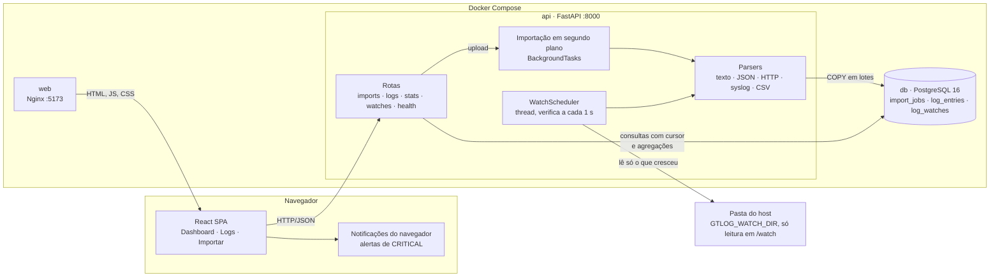

# Arquitetura

## Visão geral

O GTLog tem três serviços no Docker Compose: o frontend (`web`), a API (`api`) e o banco (`db`). O navegador só
fala com a API, por HTTP/JSON; a API é a única que acessa o banco. Os logs chegam por dois caminhos, e os dois
terminam no mesmo parser e no mesmo `COPY`:

- **Upload**: o usuário envia um arquivo pela tela Importar (ou `POST /imports`) e ele é processado em segundo plano.
- **Observação em tempo real**: uma thread da API relê, no intervalo escolhido, arquivos de uma pasta do host
  montada só para leitura em `/watch`, e importa só as linhas novas.



Princípios que guiam o desenho (detalhes e alternativas em [decisions.md](decisions.md)):

- **Um banco só, sem filas nem buscador externo.** O PostgreSQL faz armazenamento, full-text (`tsvector` + GIN) e
  agregações (`date_bin`). Menos peças para subir e para manter consistentes.
- **Ingestão em lotes com `COPY`**, no mesmo caminho para upload e observação, com progresso e contadores gravados
  na mesma transação de cada lote.
- **Consulta por cursor (keyset)**, nunca `OFFSET`, para que a página 1.000 custe o mesmo que a primeira.
- **Os mesmos filtros em tudo**: tabela, contagem, facetas e dashboard usam o mesmo construtor de condições.
- **Frontend como SPA estática** com o estado do servidor no TanStack Query e os filtros na URL.

## Componentes

| Componente | Tecnologia | Responsabilidade |
| --- | --- | --- |
| `web` | React 18 + TypeScript + Vite, servido por Nginx (porta 5173 → 80) | Telas de Dashboard, Logs e Importar. SPA estática; o Nginx só serve arquivos e faz fallback para `index.html`. |
| `api` | FastAPI + SQLAlchemy 2 + psycopg 3 (porta 8000) | Upload, processamento em segundo plano, observação de arquivos em tempo real, consulta, facetas e estatísticas. |
| `db` | PostgreSQL 16 | Armazenamento, índices, full-text e agregações. |

O backend é dividido em camadas, cada uma chamando só a de baixo:

- `app/api`: rotas, validação de parâmetros e schemas de resposta (Pydantic). Não contém regra de negócio.
- `app/services`: `importer` (upload e ingestão), `log_query` (filtros, cursor, facetas), `stats` (agregações) e
  `watcher` (agendador e leitura incremental dos arquivos observados).
- `app/parsers`: funções puras que transformam uma linha de texto em `ParsedLine` e não acessam o banco.
- `app/models`: tabelas `import_jobs`, `log_entries` e `log_watches` e seus índices.

O contrato entre parsers e importador é `ParsedLine` (`app/parsers/base.py`). O contrato entre backend e frontend é
[docs/api.md](api.md).

## Fluxo de dados


1. **Upload** (`POST /imports`): o handler é síncrono, então roda no threadpool e não bloqueia o event loop.
   `save_upload` copia o arquivo para um arquivo temporário em blocos de 1 MB. Se o primeiro KB tem byte NUL, a
   resposta é 415; se passa de `UPLOAD_MAX_MB`, 413; se o arquivo está vazio, 422. Depois disso o job é criado
   como `PENDING` e a resposta é `202` com o job.
2. **Processamento em segundo plano** (`process_import`, com sessão própria): marca `PROCESSING`, detecta o formato
   pelas 200 primeiras linhas não vazias (vence o parser com mais acertos; em empate, o mais específico) e grava o
   nome em `format`. Lê o arquivo linha a linha, em UTF-8 com BOM opcional e bytes inválidos trocados por U+FFFD.
   Linhas em branco são ignoradas e linhas que o parser rejeita entram em `invalid_lines`.
3. **Ingestão**: a cada 5.000 linhas, um `COPY log_entries (...) FROM STDIN` e a atualização dos contadores do job
   vão na mesma transação. Assim o progresso exibido sempre corresponde ao que está gravado. No fim, o job fica
   `DONE` e o arquivo temporário é apagado.
4. **Consulta**: `/logs` e `/stats` usam o mesmo construtor de filtros (`log_query.build_conditions`), então a
   tabela e o dashboard sempre concordam sobre o que é "o filtro atual".
5. **Frontend**: a tela de importação consulta o job a cada segundo. Um observador montado em `App` percebe quando
   qualquer importação termina e atualiza logs, contagem, estatísticas e facetas, em qualquer página.

## Modelo de dados

`import_jobs`: `id`, `filename`, `status` (PENDING/PROCESSING/DONE/FAILED), `format`, `total_lines`,
`parsed_lines`, `invalid_lines`, `error`, `created_at`, `finished_at`.

`log_entries`: `id` (bigint), `import_id` (FK com `ON DELETE CASCADE`), `timestamp` (timestamptz, UTC), `level`
(enum), `service` (até 100), `category` (até 50), `message`, `raw` (linha original; ambos cortados em 10.000
caracteres) e `search_vector`.

| Índice | Colunas | Para quê |
| --- | --- | --- |
| `ix_log_ts_id` | `timestamp DESC, id DESC` | Ordenação fixa da tabela e paginação por cursor sem ordenar em memória. |
| `ix_log_level_ts` | `level, timestamp DESC` | Filtro por nível (o mais comum) mantendo a ordem. |
| `ix_log_import_ts_id` | `import_id, timestamp DESC, id DESC` | Filtro por importação na ordem da tabela; também evita varredura completa no `ON DELETE CASCADE`. |
| `ix_log_service`, `ix_log_category` | `service`, `category` | Filtros por igualdade e facetas (`DISTINCT`). |
| `ix_log_search` | GIN em `search_vector` | Busca textual. |

`log_watches`: `path` (relativo a `WATCH_ROOT`), `interval_seconds`, `active`, `import_id` (a importação que recebe
as linhas), `offset` (bytes já lidos), `inode` e `head_size`/`head_digest` (SHA-256 do primeiro KB lido, para
detectar rotação), `format`, `header` (cabeçalho CSV), `last_error`, `critical_lines`/`last_critical_message`/`last_critical_at`
(para os alertas), `last_checked_at` e `next_check_at`.
O índice `ix_watch_due` (`active, next_check_at`) atende a busca do agendador.

Os índices são criados na subida da API com `CREATE INDEX IF NOT EXISTS`, depois de `create_all` (veja
[decisions.md](decisions.md#6-esquema-com-create_all--if-not-exists-sem-alembic)).

## Observação em tempo real

`WatchScheduler` (em `services/watcher.py`) é uma thread iniciada no `lifespan` da API. A cada segundo ela busca as
observações ativas com `next_check_at` vencido e chama `poll_watch` para cada uma:

1. Trava a linha da observação com `SELECT ... FOR UPDATE SKIP LOCKED`, para que dois processos da API nunca leiam
   o mesmo arquivo ao mesmo tempo.
2. Resolve o caminho de novo (links simbólicos incluídos) e confere que ele continua dentro de `WATCH_ROOT`.
3. Compara o arquivo aberto com o que foi lido antes: inode diferente, tamanho menor que `offset` ou primeiro KB
   diferente (um arquivo recriado pode reaproveitar o inode) significa rotação ou truncamento, e a leitura volta ao
   byte 0 com nova detecção de formato.
4. Lê a partir de `offset` até 16 MB e para na última quebra de linha. As linhas passam pelo mesmo parser e pelo
   mesmo `COPY` da importação por upload. Em CSV o cabeçalho guardado é reaplicado a um parser novo em cada leitura.
5. Grava as linhas, os contadores da importação e o novo `offset` na mesma transação: se algo falhar, nada é
   gravado e a próxima leitura repete o trecho, sem duplicar linhas.

Se sobrou conteúdo (mais de 16 MB de atraso), a observação fica vencida de novo e é lida no próximo segundo; senão
volta depois de `interval_seconds`. O frontend (`useWatchActivity`, montado em `App`) consulta `GET /watches` a cada 3 s
enquanto houver observação ativa e, quando os contadores sobem, atualiza contagem, dashboard e facetas. A tabela de logs só é recarregada se o usuário
estiver na primeira página, para não tirar a rolagem de quem está lendo registros mais antigos.

O arquivo é escolhido pelo seletor da tela Importar, que navega a pasta compartilhada por `GET /watches/files` (o
seletor nativo do navegador não revela o caminho do arquivo, e a API precisa dele para reler). Também é aceito o
caminho completo do host quando a pasta veio de `GTLOG_WATCH_DIR`: a API troca o prefixo `WATCH_HOST_ROOT` por
`WATCH_ROOT` antes de validar.

### Alertas de erros críticos

A cada leitura, `poll_watch` soma em `critical_lines` as linhas `CRITICAL` gravadas e guarda a última mensagem e o
horário. Não há Web Push nem servidor de notificações: o próprio frontend compara `critical_lines` entre duas
consultas a `GET /watches` (`useCriticalAlerts`) e, quando o número cresce, mostra três avisos ao mesmo tempo:

1. uma notificação do navegador (API `Notification`), com permissão pedida pelo botão **Ativar alertas**;
2. um alerta no canto da página, para quando o sistema esconde a notificação (Foco, permissões do macOS);
3. a contagem no título da aba (`(2) GTLog`) enquanto ela estiver em segundo plano.

Com os alertas ativos, a consulta continua mesmo com a aba oculta. A primeira contagem de cada observação só vira
referência depois que ela alcança o fim do arquivo, para não anunciar como novos os `CRITICAL` que o arquivo já tinha
ao ser observado ou ao recarregar a página. Clicar no alerta abre `/logs` filtrado pela importação da observação e
pelo nível `CRITICAL`.

## Paginação por cursor

A ordenação é fixa: `timestamp DESC, id DESC`. O cursor é `base64url("<timestamp ISO>|<id>")` do último item da
página, e a próxima página usa uma comparação de tuplas:

```sql
WHERE (timestamp, id) < (:ts, :id) ORDER BY timestamp DESC, id DESC LIMIT :limit + 1
```

Essa comparação segue a ordem de `ix_log_ts_id`, então o Postgres começa a ler exatamente no cursor. O custo é o
mesmo na página 1 ou na 1.000, e linhas novas não deslocam as páginas (não há duplicadas nem puladas). A consulta
pede `limit + 1` linhas para saber se existe próxima página sem fazer um `COUNT`. O total vem de uma rota separada,
`/logs/count`. Um cursor inválido devolve 422 ("Cursor de paginação inválido.").

## Busca textual

`search_vector` é uma coluna gerada pelo Postgres:

```sql
to_tsvector('simple', coalesce(service, '') || ' ' || message)  -- STORED, índice GIN
```

A configuração `simple` não aplica stemming nem stopwords. Isso é intencional: logs têm identificadores, nomes de
serviço e termos técnicos em inglês, que um dicionário de idioma deformaria. Por ser coluna gerada, o vetor nunca
fica desatualizado em relação à linha e o `COPY` não precisa calculá-lo.

Como o parâmetro `q` vira consulta (`log_query._text_condition`):

| Entrada | Consulta | Exemplo |
| --- | --- | --- |
| Palavras simples | `to_tsquery('simple', 'tok1:* & tok2:*')`: todas as palavras, por prefixo | `time pay` encontra "timeout calling payments" |
| Com aspas, ` or ` ou termo começando com `-` | `websearch_to_tsquery('simple', q)` | `"connection refused"`, `timeout or database`, `-payments` |
| Sem letras nem dígitos | `ILIKE '%...%'` em mensagem e serviço, com `%` e `_` escapados | `%` |

Os tokens do modo prefixo são extraídos com `[^\W_]+` (só letras e dígitos), então não carregam operadores de
tsquery. Além disso, o texto sempre vai como parâmetro ligado (bind), nunca concatenado na SQL.

## Estatísticas

`/stats` faz uma única varredura agrupada por `date_bin(<bucket>, timestamp)` e nível, que gera ao mesmo tempo os
totais por nível, a série temporal e o primeiro e último timestamp. O bucket (segundo, minuto, hora ou dia) é
escolhido pelo tamanho do período: o filtrado ou, sem `start`/`end`, o dos dados (um `min`/`max` que sai do índice de
timestamp). Vale o mais fino que cabe: `second` até 5 minutos, `minute` até 3 horas, `hour` até 3 dias, senão
`day`. Um bucket pedido explicitamente que daria 10.000 pontos ou mais é trocado pelo próximo maior, e a resposta
informa qual foi usado. O `date_bin` usa origem em 2000-01-01 UTC, então as fronteiras são sempre em UTC e iguais às
que a aplicação usa para preencher buckets vazios com zero. Com `start`/`end`, o preenchimento cobre o período
inteiro (um dia por hora sempre devolve 24 pontos), o que alimenta o painel "Volume por hora em um dia". Top serviços, top categorias e erros mais frequentes são consultas
`GROUP BY ... LIMIT 10`. Nos erros, os números da mensagem são trocados por `#` (`regexp_replace`), para juntar
variações como `timeout calling auth after #ms`.

## Frontend

- **Estado do servidor**: TanStack Query. A tabela usa `useInfiniteQuery` com `next_cursor` como `pageParam`
  (páginas de 200). Enquanto um filtro novo carrega, `keepPreviousData` mantém as linhas anteriores esmaecidas em vez
  de piscar um skeleton. Os logs são imutáveis depois de importados, então `staleTime` é de 5 min e não há refetch
  ao focar a janela. Ao fim de uma importação, a lista de logs é resetada (não invalidada, para não refazer todas as
  páginas já carregadas).
- **Filtros na URL**: `useUrlFilters` lê e escreve os filtros em `searchParams` com `replace`, o que deixa a visão
  compartilhável, faz ela sobreviver ao recarregar e evita que o botão Voltar desfaça cada tecla digitada. A busca
  tem debounce. Os cliques no dashboard (ponto da série, nível, serviço, categoria, erro frequente) levam para
  `/logs` com os filtros correspondentes.
- **Virtualização**: `@tanstack/react-virtual` renderiza só as linhas visíveis, mesmo com milhares carregadas. Perto
  do fim da lista, a próxima página é buscada (scroll infinito). Abaixo do breakpoint compacto, as linhas viram
  cartões e a tabela continua virtualizada.
- **Dashboard**: o gráfico "Volume ao longo do tempo" usa o bucket que a API devolver. Arrastar sobre ele seleciona
  um trecho e vira um filtro de período (`start`/`end` na URL), então a API responde com um bucket mais fino, até
  segundos; **Ver todo o período** desfaz o zoom. O painel "Volume por hora em um dia" pede um dia escolhido no
  calendário com `bucket=hour` e mostra as 24 horas. Os horários dos gráficos e da tabela são exibidos em UTC.
- **Code splitting**: as três páginas são `lazy`. O Recharts fica só no chunk do dashboard, então a tela de logs
  não o baixa.
- **Estilo**: CSS próprio com variáveis (`frontend/src/index.css`), com tema claro/escuro via `data-theme`.

## Tratamento de erros

Na API:

- Todo erro devolvido ao usuário tem o formato `{"detail": "mensagem em português"}`. O handler de
  `RequestValidationError` troca a lista em inglês do FastAPI por uma frase que cita o parâmetro
  (`Valor inválido para o parâmetro 'level'.`).
- Upload: 413 (tamanho), 415 (binário), 422 (vazio). Se a criação do job falhar, o arquivo temporário é apagado.
- Consulta: 422 para `start >= end`, cursor inválido, valores fora do enum ou acima dos limites (`q` até 200
  caracteres, até 20 valores por filtro repetível); 404 para importação ou registro inexistente.
- Linhas inválidas não são erro fatal: entram em `invalid_lines` e a importação termina `DONE`. Um formato não
  reconhecido termina em `FAILED` com "Formato de log não reconhecido.".
- Falha inesperada durante a importação: rollback da transação corrente, `DELETE` das linhas já gravadas daquele
  job (os lotes anteriores já tinham sido commitados), status `FAILED` com "Erro inesperado ao processar o
  arquivo." e o stack trace no log do servidor, sem expor detalhes ao cliente.

No frontend:

- O cliente HTTP (`api/client.ts`) converte qualquer falha em `ApiError` com mensagem em português: o `detail` da
  API quando existe, senão uma mensagem por status, e para falha de rede "Não foi possível conectar à API...".
- Cada tela tem estados de carregando, vazio e erro com botão "Tentar novamente". O cabeçalho mostra o status da
  API (`/health` a cada 30 s).
- O seletor de arquivo filtra por extensão e tipo (`.log`, `.txt`, `.json`, `.jsonl`, `.ndjson`), mas a validação
  real é a do servidor.
